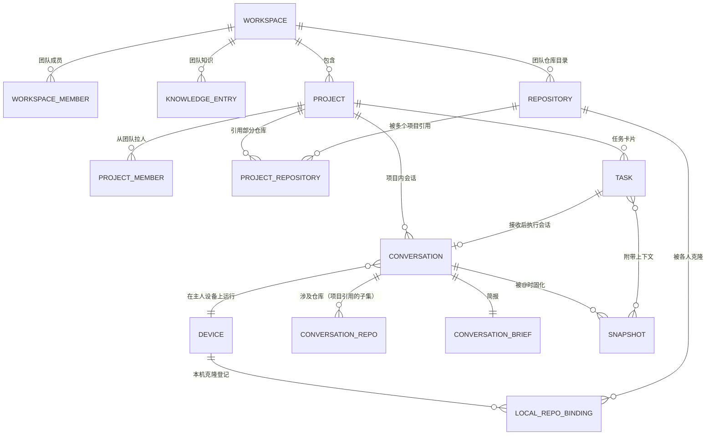
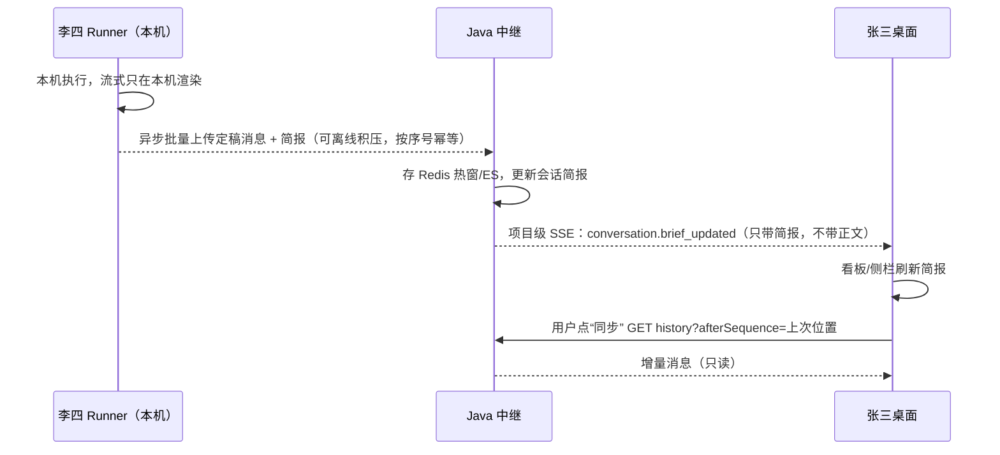
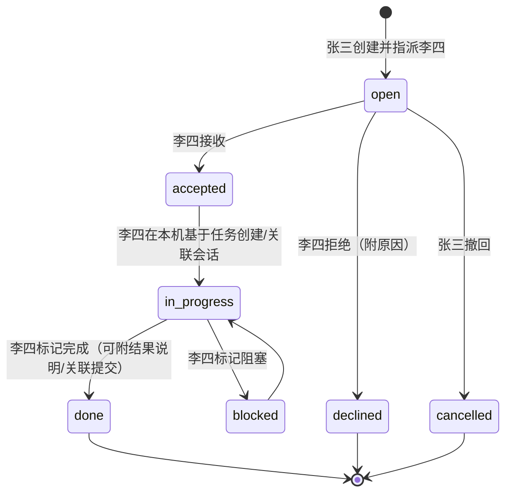

# Java 中继层调整方案（基于 11-12 产品讨论结论）

> 状态：方案稿 v2（2026-11-12 15:10，D1～D11 已由用户拍板，见 §8），未改代码和文档。对照基线：[多人协作工作台顶层设计](../architecture/多人协作工作台顶层设计.md)、[HC-210 Spec](../spec/HC-210-Java高可用基础框架.md)、现有 `services/collaboration-server` 源码（V001～V003、[RouteCatalog.java](../../../services/collaboration-server/src/main/java/workbench/collaboration/interfaces/http/RouteCatalog.java)）。

## 1. 最大变化：从“远程共同操作”改为“各跑各的，只读共享，改动走任务”

现在的设计（HC-192/195/198/210）是**共同操作一个会话**：工作区成员都能往 A 的会话发消息，Java 把 `execution.start` 经 WSS 派发到 A 的 Runner，在 A 的电脑上执行；交接只换“当前接续人”；SSE 实时推送给所有人。

新结论把这条路线**整体否掉**：

| 维度 | 现有设计 | 新结论 | 对 Java 的含义 |
| --- | --- | --- | --- |
| 执行权 | 成员都可往他人会话发输入，Java 远程派发 | 只有会话主人在自己电脑上驱动 Agent | **删除跨人派发链路**（`execution.start/cancel` 下发、`wb.daemon.commands`、Redis 设备路由表、远程审批回答） |
| 协作单位 | 1 个工作区 + 设备“共享项目”（= 一个本地目录） | Workspace = 团队（人）；Project = 用户自建业务项目，挑团队成员，含多个代码仓库 | 新增 Project / ProjectMember / Repository；原 `wb_device_project` 降级为“本机仓库登记” |
| 会话共享 | 工作区内共享，实时推送 | 只在 Project 内可见，只读；看简报，点同步才拉 | 会话粒度 SSE 改为**项目级轻量通知 + 按需拉取** |
| 请别人改 | 交接（转接续人） | @人 → 发 Task 卡片，对方接收后在自己机器上让 Agent 做 | **交接（HC-198 handoff）作废**，新增 Task 领域 |
| 了解进度 | @会话引用快照 | @会话 → 对方最新消息快照进入我的 Agent 上下文 | 原“引用草稿/快照”设计可保留，范围收窄到 Project |
| 知识 | 无 | Team 级规约、术语，可被会话引用 | 新增 Knowledge 领域 |
| 进度可视化 | 无 | Project 看板：人 × 会话 × 任务 | 新增看板读模型 |

> [!IMPORTANT]
> 一句话安全不变量：**Java 永远不代表 A 向 B 的设备下发会让 Agent 执行或改代码的命令。** 跨机器只有“上传自己的状态”和“读取别人的已上传状态”两种流向。Runner 只执行本机登录用户在本机界面发起的操作。

## 2. 新领域模型



| 概念 | 含义 | 存储位置 |
| --- | --- | --- |
| Workspace（团队） | 组织单位，如“开发组”；成员关系来自组织架构（初版预置，内网阶段对接） | TDSQL（沿用） |
| Project | 用户创建；成员 ⊆ 团队成员；创建者为负责人 | TDSQL 新表 |
| Repository | **团队级仓库目录**中的一项（名称 + 远程地址 + 默认分支），与谁的电脑、哪个项目无关；团队成员维护 | TDSQL 新表 |
| ProjectRepository | 项目对团队仓库的**引用关系**；项目只引用本次涉及的那部分仓库，移出引用不影响仓库本身和其他项目 | TDSQL 新表 |
| LocalRepoBinding | “张三的设备 X 上克隆了团队仓库 A”；绑定在团队仓库上，一次登记、所有项目复用；本地绝对路径**只存本机**，云端只存设备 ID + 仓库 ID | TDSQL（替代 `wb_device_project`） |
| Conversation | 主人 = 创建者，固定不变；绑定主人设备 + 所属 Project + 涉及仓库（必须是项目已引用仓库的子集，可多个） | TDSQL（改造） |
| Brief（简报） | 会话标题、状态（空闲/运行中/等待审批/出错）、最近一条用户诉求与 Agent 结论摘要、已同步到第几条、更新时间；带 `brief_source`（`rule`/`agent`）字段，首版只写 `rule` | TDSQL（会话行内字段，小） |
| 会话消息 | 主人 Runner 异步上传的定稿消息 | Redis 热窗 + ES（沿用 HC-210） |
| Snapshot | 被 @ 时固化的“最新 N 条消息/选区”只读文本，不可变 | TDSQL（有大小上限）或 ES，见决策 D5 |
| Task | 任务卡片：发起人、指派人、标题、描述、附带快照/知识引用、状态 | TDSQL 新表 |
| KnowledgeEntry | 团队知识条目（规约/术语/通用说明），带版本 | TDSQL 元数据 + 正文；ES 做检索 |

## 3. 关键流程（输入 → 判断 → 执行 → 输出）

### 3.1 会话异步同步与按需拉取（替代实时推送）



- 上传方：仅会话主人的设备凭据可上传该会话；序号由主人 Runner 单调分配（只有一个写者，不再需要 Java 加行锁分配 `next_sequence`），Java 校验连续、幂等去重。
- 上传内容（D2）：用户消息、Agent 定稿回复、**工具调用摘要**（工具名、目标文件/命令的简述、成功/失败、改动行数等），不含工具完整输出、文件正文和流式碎片。消息类型字段固定为 `user` / `assistant` / `tool_summary` / `status`。
- 上传节奏：消息定稿/执行终态时触发，批量 + 节流（如 ≤1 次/2s）；离线时本机积压，上线补传。传输为普通 HTTPS（D1），没有任何 Java → Runner 的下行通道。
- 查看方：张三本地缓存“已同步到第 N 条”，点同步时只拉增量；不建立该会话的持续订阅。
- 简报（D4）：首版由 Runner 按规则拼接后随同步上传（最近一条用户诉求 + 最近一条 Agent 结论前若干字 + 状态），`brief_source=rule`。后续增强为 Agent 总结（`brief_source=agent`），接口和字段已预留，**登记为待办 B1**。

### 3.2 @会话：了解进度（只读快照进入我的 Agent）

```text
张三输入 @李四的会话 → Java 校验：同一 Project 成员 + 会话属于该 Project
  → 取 Java 已同步的最新 20 条（默认值，可调；或仅简报）生成不可变 Snapshot 存 TDSQL，返回预览
  → 张三发送时，张三的 Runner 把快照文本作为“参考材料”拼进本机 Agent 输入
  → 李四的会话与 Agent 不受任何影响
```

- 快照只来自**已上传**的内容；李四离线时能拿到上次同步的内容，并在预览中标明“同步于 xx 分钟前”。
- 快照文本对张三的 Agent 是**不可信参考数据**，不当作指令（防提示注入）。
- 沿用原 HC-198“不可变草稿 → 发送时复制为正式引用”设计；差异是**发送不再经过 Java 派发**——张三的输入在本机执行，Java 只记录“这次引用了哪个快照”（随张三会话异步上传即可）。

### 3.3 @人：发 Task 卡片（请别人改）



- 状态迁移只能由对应的人在自己的桌面发起（指派人：接收/拒绝/推进/完成；发起人：撤回/改描述），Java 用“预期状态 + 版本号”做 CAS，重复请求幂等。
- “接收后交给 Agent 开发”发生在**李四本机**：李四桌面拉取任务详情（描述 + 附带快照 + 知识引用），在本机新建会话，Java 只登记 `task.conversation_id` 关联。
- Java 推送 `task.assigned / task.changed` 到相关人的用户级通知流；**没有任何下行到 Runner 的执行命令**。

### 3.4 团队知识引用

- 团队成员可增改知识条目（初版不做审批），每次修改生成新版本。
- 会话引用方式（D6）：首版**只支持 `@知识` 显式引用**（固化为某版本快照）。“项目默认引用的知识集合、新会话自动注入”不进首版，**登记为待办 B2**；首版不建对应表和接口。
- 知识对 Agent 同样是参考材料，不构成权限或运行配置。

### 3.5 Project 看板（读模型）

- 维度：成员 × { 会话简报列表（状态/最近更新/涉及仓库）、任务（我发出的/我收到的，按状态分列） }。
- 实现：一个聚合查询接口，从 TDSQL 的会话行（简报字段）+ 任务表组装；数据量小，不需要 ES。前端打开看板时拉一次，之后靠项目级 SSE 的轻量事件增量刷新。

## 4. 接口设计调整

### 4.1 保留（小改）

| 路由 | 调整 |
| --- | --- |
| `/health`、`/api/v1/meta`、`/auth/*` | 不变 |
| `GET /workspaces`、`GET /workspaces/{ws}/members` | 不变（团队成员） |
| `POST/GET /workspaces/{ws}/devices`、`.../revoke` | 不变（设备登记） |
| `GET .../conversations/{c}/history` | 路径改挂到 Project 下；只读；授权改为“Project 成员” |

### 4.2 删除

| 路由/能力 | 原因 |
| --- | --- |
| `POST .../conversations/{c}/inputs`（他人向会话发输入） | 不再远程驱动 Agent；主人输入在本机发生，结果随同步上传 |
| `POST .../executions/{e}/cancel`、`GET .../executions/{e}`、`GET /requests/{id}?operation=input.send|execution.cancel` | 同上，执行生命周期归主人本机 |
| `GET .../conversations/{c}/events`（会话级实时 SSE） | 改为项目级/用户级通知流 + 按需拉取 |
| `POST .../projects/{p}/stop-sharing`、`POST /device/projects`（设备项目共享） | “按目录共享”概念被 Project 成员制替代 |
| 计划中的 handoff 接口（HC-198） | 被 Task 替代 |
| WSS `execution.start/cancel` 下行、远程审批回答 | 安全不变量 |

### 4.3 新增

**Project 与仓库**

| 方法 路由 | 说明 |
| --- | --- |
| `POST /workspaces/{ws}/projects` | 创建项目（创建者自动为负责人、成员） |
| `GET /workspaces/{ws}/projects` | 我参与的项目 |
| `GET/PATCH /workspaces/{ws}/projects/{p}` | 详情/改名/归档（负责人） |
| `POST/DELETE /workspaces/{ws}/projects/{p}/members[/{userId}]` | 从团队拉人/移出（负责人） |
| `GET/POST /workspaces/{ws}/repositories` | 团队仓库目录：列表/登记（团队成员） |
| `GET/PATCH /workspaces/{ws}/repositories/{repoId}` | 详情/改名、改默认分支、归档（归档后不能被新项目引用，已有引用只读保留） |
| `PUT/DELETE /workspaces/{ws}/projects/{p}/repositories/{repoId}` | 项目引用/取消引用团队仓库（负责人）；取消引用不影响已有会话的历史关联 |
| `GET /workspaces/{ws}/projects/{p}/repositories` | 项目已引用的仓库，附“我本机是否已克隆” |
| `PUT/DELETE /device/repo-bindings/{repoId}`（设备凭据） | 本机登记“我克隆了这个团队仓库”，不传绝对路径；所有引用该仓库的项目共用 |

**会话（只读共享）**

| 方法 路由 | 说明 |
| --- | --- |
| `POST /workspaces/{ws}/projects/{p}/conversations` | 主人在本机新建会话时登记（含设备、涉及仓库、可选 taskId） |
| `GET /workspaces/{ws}/projects/{p}/conversations?ownerId=&status=` | 项目内会话简报列表 |
| `GET .../conversations/{c}` | 单个会话简报 |
| `GET .../conversations/{c}/history?afterSequence=&limit=` | 点“同步”时增量拉取 |
| `POST /device/conversations/{c}/sync`（设备凭据，主人设备） | 批量上传定稿消息 + 简报；序号连续、批次幂等 |

**@会话快照**

| 方法 路由 | 说明 |
| --- | --- |
| `POST /workspaces/{ws}/projects/{p}/snapshots` | 入参：来源会话 + 范围（最新 N 条 / 序号区间 / 仅简报）；返回不可变快照与预览 |
| `GET .../snapshots/{snapshotId}` | 读取（Project 成员） |

**Task**

| 方法 路由 | 说明 |
| --- | --- |
| `POST /workspaces/{ws}/projects/{p}/tasks` | 创建并指派（指派人须为 Project 成员），可附 snapshotIds / knowledgeRefs |
| `GET .../tasks?assignee=me&status=` | 列表 |
| `GET/PATCH .../tasks/{t}` | 详情/改描述（发起人，open 状态） |
| `POST .../tasks/{t}/transitions` | `{action: accept|decline|start|block|complete|cancel, expectedVersion, requestId, note?}` |
| `PUT .../tasks/{t}/conversation` | 指派人关联执行会话 |

**知识**

| 方法 路由 | 说明 |
| --- | --- |
| `GET/POST /workspaces/{ws}/knowledge` | 列表（支持搜索）/新建 |
| `GET/PUT/DELETE /workspaces/{ws}/knowledge/{k}` | 读/改（生成新版本）/归档 |
| `GET /workspaces/{ws}/knowledge/{k}/versions/{v}` | 读取固定版本（引用使用） |

**看板与通知**

| 方法 路由 | 说明 |
| --- | --- |
| `GET /workspaces/{ws}/projects/{p}/board` | 成员 × 会话简报 × 任务聚合 |
| `GET /workspaces/{ws}/notifications/stream`（SSE） | 用户级通知：`task.assigned`、`task.changed`、`conversation.brief_updated`（仅我参与的项目）、`knowledge.updated`、`project.member_changed` |

### 4.4 设备通道：WSS 改为 HTTPS（D1 已定）

| 接口（设备凭据） | 说明 |
| --- | --- |
| `POST /device/conversations/{c}/sync` | 批量上传定稿消息 + 工具调用摘要 + 简报 |
| `POST /device/heartbeat` | 在线心跳（如 30s 一次），Java 只用于展示“设备在线” |
| `PUT/DELETE /device/repo-bindings/{repoId}` | 本机仓库登记 |

删除：`GET /api/v1/device/channel`（WSS 升级）、`DaemonWebSocketHandler/Config`、Redis 设备路由表、`wb.daemon.commands`。没有下行命令通道，“不能远程驱动别人的 Agent”在协议层面就成立，不靠代码约束保证。Java 多节点无连接粘性。

## 5. 数据与中间件调整

### 5.1 TDSQL

**建库方式（D7 已定）：不用 Flyway，只维护一份完整 DDL。**

- 删除 `db/migration/V001～V003` 与 `flyway-core`/`flyway-mysql` 依赖、`application.yml` 的 `flyway` 配置、`Application` 的 `migrate` 命令；`Foundation` 中的迁移校验改为**启动只读核对**：检查必需表/关键列存在，缺失则拒绝启动并打印缺失清单，**应用从不执行 DDL**。
- 新增唯一文件 `src/main/resources/db/schema.sql`（完整建表）+ `db/demo-data.sql`（预置演示用户/团队，可选）。企业内由 DBA 手工执行；开发环境用脚本执行同一文件。
- 结构变更期间直接改这一份文件并重建库；发版后若需变更，再另议增量 SQL 交付方式（**登记为待办 B4**）。
- DDL 只用 MySQL 兼容常规语法：无外键、无触发器、无 JSON 列查询，沿用 `pk_id` 自增 + 业务 `id` 唯一索引、utf8mb4。

**多团队（D11 已定）：数据层支持一人多团队，功能首版只做一个团队。**

- `wb_workspace_member` 已是多对多，保持；所有业务表都带 `workspace_id`，查询一律按团队隔离。
- `wb_device` **去掉 `workspace_id`**：设备属于用户，不属于团队，一台电脑可服务该用户所在的所有团队。
- 首版 UI 登录后自动进入第一个团队、不提供切换；接口按路径中的 `{ws}` 处理，不假设只有一个。**多团队切换 UI 登记为待办 B3。**

| 表 | 动作 | 要点 |
| --- | --- | --- |
| `wb_user`、`wb_workspace`、`wb_workspace_member` | 保留 | — |
| `wb_device` | 保留并改 | 删 `workspace_id`；归属仅 `owner_user_id` |
| `wb_device_project` | **删除** → `wb_local_repo_binding` | `(device_id, repository_id)` 唯一；去掉 `share_enabled/share_version` |
| `wb_repository` | 新增（团队级） | id、workspace_id、name、remote_url、default_branch、status(active/archived)；`(workspace_id, remote_url)` 唯一 |
| `wb_project` | 新增 | id、workspace_id、name、description、owner_user_id、status(active/archived)、version |
| `wb_project_member` | 新增 | `(project_id, user_id)` 唯一；`idx(user_id)`；`status(active/removed)`，移出时置 removed 而非删除（D9 需要追溯） |
| `wb_project_repository` | 新增（引用关系） | `(project_id, repository_id)` 唯一；`idx(repository_id)` |
| `wb_conversation` | **改造** | 删 `current_user_id`、`active_execution_id`、`next_sequence`；`created_by_user_id` → `owner_user_id`；`project_id` 语义改为业务项目；保留 `device_id`、`agent_config_id`(展示)；新增 `task_id`、`status`、`brief_text`、`brief_source`、`brief_updated_at_ms`、`synced_sequence`；索引 `(project_id, updated_at_ms)`、`(owner_user_id)` |
| `wb_conversation_repository` | 新增 | 会话涉及的仓库（多个，须属于项目引用集合） |
| `wb_snapshot` | 新增 | id、project_id、source_conversation_id、from/to sequence、message_count（默认 20）、text（上限 64KB）、sha256、created_by、source_synced_at_ms |
| `wb_task` | 新增 | id、project_id、title、description、creator_id、assignee_id（单值，D8）、status、version、conversation_id、时间戳；`idx(assignee_id,status)`、`idx(project_id,status)` |
| `wb_task_reference` | 新增 | task ↔ snapshot / knowledge_version |
| `wb_task_event` | 新增 | 状态变化审计（谁、何时、从→到、备注） |
| `wb_knowledge_entry` / `wb_knowledge_version` | 新增 | 条目头 + 不可变版本正文 |
| `wb_handoff`、`wb_message_reference`（HC-198 计划） | **取消** | 由 task / snapshot 替代 |

> HC-210“TDSQL 封顶 8 张表”的约束需要放宽：新增表都是**低频控制面小表**（任务、项目、知识），不违背“不放流水表”的初衷；消息正文仍不进 TDSQL。

### 5.2 Redis / Kafka / ES

| 组件 | 调整 |
| --- | --- |
| Redis | 删 `wb:daemon:presence:*` 与 `wb:exec:*`；保留幂等键、会话消息热窗（供同步拉取）；新增设备心跳 `wb:device:hb:{deviceId}`（短 TTL，只做在线展示） |
| Kafka | 删 `wb.daemon.commands`；`wb.conversation.events` → `wb.collab.notifications`（按 projectId/userId 分区，驱动用户级 SSE）；保留 `wb.search.index`，新增知识条目索引 |
| ES | 保留 `wb_message_v1`（routing 可改为 projectId，便于项目内检索）；`wb_conversation_handoff_v1` 改为 `wb_conversation_v1`（简报检索）；新增 `wb_knowledge_v1` |

### 5.3 Java 分包（DDD 四层不变，领域重划）

```text
domain
├── identity       User / Workspace / WorkspaceMember（保留）
├── project        Project / ProjectMember / ProjectRepositoryRef（新增）
├── repository     Repository（团队仓库目录）/ LocalRepoBinding（新增）
├── device         Device（删除 SharedProject、DaemonCommandPort、DaemonPresence 路由）
├── conversation   Conversation / Brief / SyncBatch 校验（改造，删执行派发）
├── snapshot       Snapshot（新增，原 reference 规划落这里）
├── task           Task / TaskStateMachine（新增）
├── knowledge      KnowledgeEntry / Version（新增）
└── access         ProjectAccessPolicy：统一“谁能读/写什么”（新增）
execution 包：整体删除（ExecutionStateMachine、ExecutionAuthDomainService 等）
application：ProjectAppService、ConversationSyncAppService、SnapshotAppService、TaskAppService、KnowledgeAppService、BoardQueryService、NotificationAppService
```

## 6. 权限矩阵

| 操作 | 团队成员（非项目成员） | 项目成员 | 会话主人 | 项目负责人 |
| --- | --- | --- | --- | --- |
| 看项目列表/看板 | 否 | 是 | — | 是 |
| 看会话简报 / 拉历史 / @会话快照 | 否 | 是（只读） | 是 | 是（只读） |
| 向会话输入、取消、回答审批 | 否 | **否** | 仅本机，不经 Java | **否** |
| 上传会话同步 | 否 | 否 | 仅主人设备凭据 | 否 |
| 创建任务并指派 | 否 | 是（指派给项目成员） | — | 是 |
| 任务接收/推进/完成 | — | 仅指派人 | — | 否 |
| 任务撤回/改描述 | — | 仅发起人 | — | 否（D8） |
| 维护团队仓库目录 | 是 | 是 | — | 是 |
| 管理项目成员 / 项目仓库引用 | 否 | 否 | — | 是 |
| 读/写团队知识 | 是 | 是 | — | 是 |

移出项目成员后（D9）：本人立即失去读取权，其设备对该项目会话的上传被拒；他已有的会话保留在项目内，对其他成员只读可见，看板标注“已离开项目”。

## 7. 对现有任务与文档的影响

| 文档/任务 | 影响 |
| --- | --- |
| 顶层设计 §4.4、§6、§7、§8 | 设备共享、远程执行、交接、引用四节需重写 |
| HC-195 共享会话与实时同步 | 远程发送/排队/派发/会话 SSE 全部改为“主人上传 + 按需拉取”；已实现的 inputs/cancel/events 需回收 |
| HC-196 设备接入与本机执行 | 设备通道降为上传 + 心跳（D1）；本机执行改由本机桌面直接驱动 Runner，不再等云端派发 |
| HC-198 会话交接与内容引用 | 交接作废；引用保留并改为“项目内快照”；建议重新定题或拆分 |
| HC-210 | Kafka topic、Redis key、表上限、`execution` 包需修订 |
| HC-208 协作导航 | 左侧导航需改为 团队 → 项目 → 会话/任务/看板/知识 |
| `workbench-contracts` | OpenAPI/事件 schema 同步改 |

建议新增任务（编号顺延，走完整流程 task → spec → plan → todo）：
1. **项目与仓库模型**（团队仓库目录 / Project / Member / 项目仓库引用 / LocalRepoBinding + 访问策略 + 单文件 DDL 改造）
2. **会话只读同步与简报**（上传、简报、按需拉取、回收远程执行链路）
3. **会话快照与@引用**（承接 HC-198 引用部分）
4. **任务卡片**（状态机、通知）
5. **团队知识**
6. **项目看板与用户通知流**

依赖顺序：1 → 2 → (3, 4, 5 可并行) → 6。

> 实施登记（2026-11-12）：上述六项建议经统筹合并为两个任务管理，粒度以"可演示停点"承接——[HC-211 协作模型重构与只读同步](../task/HC-211-协作模型重构与只读同步.md) 覆盖 1+2（含旧链路拆除，停点：DDL/拆除 → 组织层 → 路由/权限 → 会话同步）；[HC-212 协作应用与看板通知](../task/HC-212-协作应用与看板通知.md) 覆盖 3+4+5+6（停点：快照 → 任务 → 知识 → 看板与通知）。

## 8. 已定决策（2026-11-12）

| # | 决策 |
| --- | --- |
| D1 | 设备通道 WSS 改为 HTTPS 上传 + 心跳，无下行通道 |
| D2 | 同步定稿消息 + 工具调用摘要 |
| D3 | 会话可涉及多个仓库；仓库归团队，项目通过引用关系选用其中一部分，会话仓库 ⊆ 项目引用 |
| D4 | 简报首版规则生成，预留 `brief_source`，Agent 总结后续做（B1） |
| D5 | 快照存 TDSQL，默认最新 20 条，单份 ≤64KB |
| D6 | 知识首版只显式 @，默认注入后续做（B2） |
| D7 | 不用 Flyway，只维护一份完整 `schema.sql`，应用启动只核对不建表 |
| D8 | 任务一对一指派，仅发起人可撤回 |
| D9 | 移出成员的会话保留在项目内只读可见，本人不能再上传 |
| D10 | 不允许查看他人设备的实时文件/Git，跨机器只看已同步内容 |
| D11 | 数据层支持一人多团队，首版功能只做一个团队（B3） |

## 9. 后续待办登记（不进首版，需写入 Task/架构文档留痕）

| # | 内容 | 首版预留 |
| --- | --- | --- |
| B1 | 会话简报由 Agent 总结生成 | `wb_conversation.brief_source` 字段；同步接口简报字段带来源 |
| B2 | 项目默认引用知识集合、新会话自动注入 | 无表无接口；知识版本不可变，后续可直接引用 |
| B3 | 多团队切换 UI | 所有接口按路径 `{ws}` 隔离；设备不绑团队 |
| B4 | 发版后的库结构增量变更交付方式（企业内无 migration 工具） | 单文件 DDL + 启动核对，缺表/缺列时给出明确清单 |
