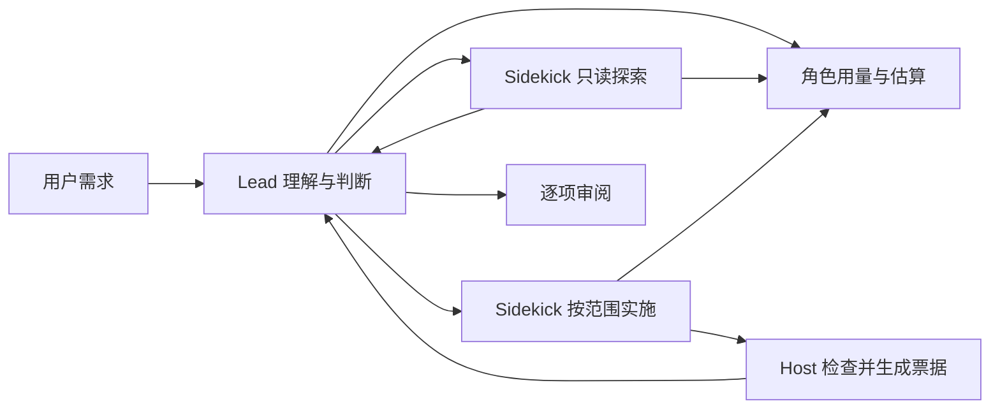

# 双模型探索与度量：行为规格

## 一、背景与目标

当前角色用量仅供诊断；Lead 自己承担大范围探索；反馈和故障处置混在长提示词中。目标是让用户看懂消耗，让 Sidekick 承担可隔离的只读调查，并提醒 Lead 在重复失败时换策略。

依据和取舍见 [审查](../research/189-Fusion改进审查.md)，需求见 [Task](../task/archive/HC-189-双模型探索与度量.md)。不把逆向字符串当成实际性能结论，不承诺固定降本比例。

## 二、设计思路

- 用量按实际角色、模型 profile、调用累计，保存在任务中。缺失值为未知，不能伪装成零；缓存占比仅在有完整缓存数据时给出。
- 模型 profile 可配置每百万 token 单价和币种。金额是已观测用量按配置计算的估算；节省口径是“Sidekick 同样 token 若按 Lead 单价”的差额，不是账单或真实全 Lead 对照实验。
- `fusion_explore` 使用独立的只读 Sidekick 身份和短期 checkpoint。保留 Lead 核实读工具。不授予文件/命令权限，不生成实施报告或验收票据。
- 运行身份、取消、真实审批及时间线继续统一处理；探索运行要显示，不能因为不改任务阶段就隐藏活动。
- 同一失败在不同轮次连续出现时提示换策略；不自动取消、放权或宣告失败。相同报告的重复读取不算新一轮。

## 三、整体架构

配置只负责可信价格和提示词；用量组件负责聚合与计算；服务负责派单和审阅；Host 负责模型资源与运行；Protocol 定义状态；CLI 的共享状态组件供终端和 Web 使用。新增能力放独立模块，避免继续堆入大文件。

## 四、详细设计

### 用量和配置

`models.profiles.<id>.pricing`：`currency`、`input_per_million`、`output_per_million`、`cached_input_per_million`，非负有限数，单位和币种显式指定。未配置不出金额；缺失必要用量或缓存单价时不假定免费。禁止读取外部价格表或按模型别名猜价格。

每个执行片段记录唯一事件、实际角色与各次模型调用明细，重试单独统计；恢复与重复事件不得重复计数。多模型调用的一次图执行必须累计所有调用。失败缺失用量标记不完整。迟到用量可更新统计，不能复活终态任务或更改写权限。故障只读核查不写回旧任务，也不套用旧模型单价；它仍保留 Run 诊断。

`fusion.progress` 和 `fusion.read/status` 返回可选的 `usage`；角色包含 profile、输入/输出/缓存、已观测调用数、数据完整性；金额包含币种、两侧估算和假设差额。状态投影只输出固定字段，不泄露 URL、Key、Header 或提示词正文。

### 只读探索

工具输入：调查问题 `question`。无需 allowed_paths；结果为摘要和 evidence ID，明确未验收。仅正常 Lead 可调用，原始权限必须允许 task；Plan、inspection、已结束任务拒绝调用。工具暴露读能力，守卫同时拒绝写、命令、报告提交与再次委派。每次探索独立 checkpoint，退出即清理；不污染实施 Sidekick 历史和首轮身份。

探索过程中原任务 phase/revision/round/ticket 不变；生命周期单独记录，不取得写者租约；父 Run 取消时停止子执行并留失败/取消事实。保存有界、脱敏摘要，Lead 必须核实关键结论。

### 提示词与反馈

Lead 提示词描述理解目标、批量探索、核实关键结论、一次收齐返工反馈、真实说明进度。协议步骤放工具说明和状态建议中。保留“验收后才能说完成”。不隐藏角色，不把普通业务阈值/查询一概列为禁止任务；Host 的检查定义不能被 Worker 改写或冒充成功。

可信 Fusion profile 增加 `lead_prompt_append`、`sidekick_prompt_append`，纳入配置与提示词指纹；不返回正文。追加文字不能扩大硬权限。

重复失败提醒比较最近两轮归一化 unresolved 和相同计划的失败摘要。仅提示改变实现、缩小任务或向用户解释阻塞；不扩充返工次数，不放开验收。

### 边界和验证

不直接在 before_model 注入运行中用户消息；旧在途写入、需求版本和票据需要统一的可中断控制协议，单点注入不足以保证正确性。保留取消当前轮后反馈。

不把 Lead 改成可写角色，不跨任务复用原 checkpoint，不发付费缓存保活请求。配置相同模型别名或更大上下文窗口不等于错误，不据此告警。真实相同端点与设置、同币种明确价格才能给出有依据的配对提醒。

协议两端、聚合/恢复/未知值、只读逃逸、取消、返工、压缩后任务单、提示词指纹均需测试。现有检查、快照、资源协调与验收行为保持。
